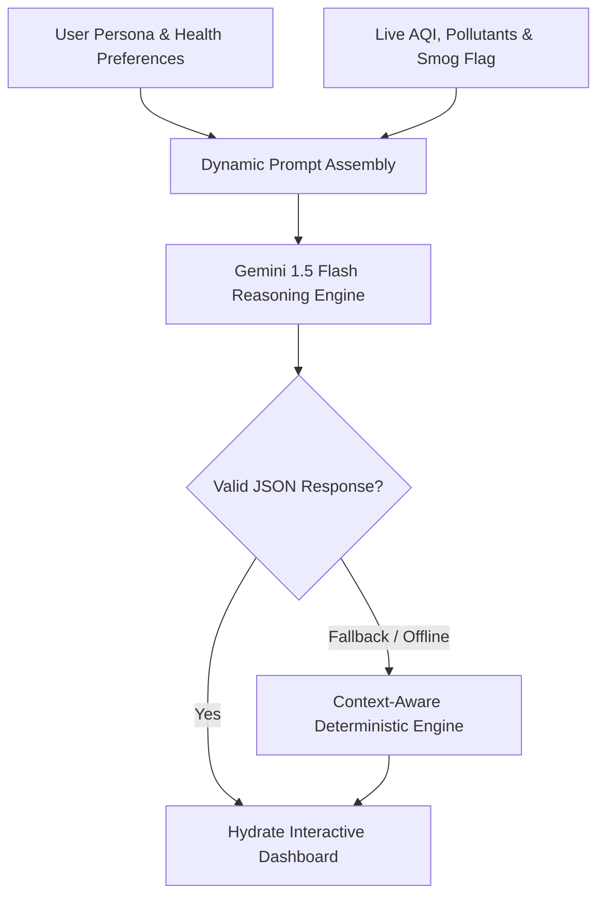

# 🌫️ VayuGuard AI (Urban Air Quality Assistant)

> **Challenge 6: Urban Air Quality Assistant** — An advanced Generative AI-powered web platform helping urban families and communities navigate severe winter smog and air pollution through personalized low-emission routines, indoor air quality hacks, and scientifically justified sustainable alternatives.

[](https://vayu-guard-ten.vercel.app/)
[](https://github.com/SparshM8/VayuGuard)
[](https://youtu.be/GrbySw0j4k8)
[](https://github.com/SparshM8/VayuGuard)
[](https://lnkd.in/p/gTSBfdGX)

- 🌐 **Live Deployed App**: [https://vayu-guard-ten.vercel.app/](https://vayu-guard-ten.vercel.app/)
- 📁 **Public GitHub Repository**: [https://github.com/SparshM8/VayuGuard](https://github.com/SparshM8/VayuGuard)
- 🎥 **Video Demo Walkthrough**: [https://youtu.be/GrbySw0j4k8](https://youtu.be/GrbySw0j4k8)
- 📢 **LinkedIn Post & Architecture Walkthrough**: [https://lnkd.in/p/gTSBfdGX](https://lnkd.in/p/gTSBfdGX)

---

## 📋 Table of Contents
1. [Overview & Chosen Vertical](#-overview--chosen-vertical)
2. [Problem Statement Alignment](#-problem-statement-alignment)
3. [Core Functionalities & Objectives](#-core-functionalities--objectives)
4. [Architecture & Technical Design](#-architecture--technical-design)
5. [Real-time Data Sourcing & Transparency](#-real-time-data-sourcing--transparency)
6. [Generative AI Prompt Flow & Personalization](#-generative-ai-prompt-flow--personalization)
7. [Approach, Logic & Assumptions](#-approach-logic--assumptions)
8. [Impact Simulator & What-If Modeling](#-impact-simulator--what-if-modeling)
9. [Security, Performance & Accessibility](#-security-performance--accessibility)
10. [Test Suite & Validation](#-test-suite--validation)
11. [Getting Started & Local Setup](#-getting-started--local-setup)
12. [Deployment & Evaluation Checklist](#-deployment--evaluation-checklist)

---

## 🎯 Overview & Chosen Vertical

- **Track / Challenge**: `Challenge-6: Urban Air Quality Assistant`
- **Target Persona**: Urban families with children, daily commuters, elderly residents, active athletes, remote workers, and students living in pollution hotspots (e.g., Delhi NCR, Mumbai, Kolkata, Beijing, London).
- **Core Mission**: Severe winter smog, crop stubble burning, and atmospheric temperature inversions frequently trap hazardous particulate matter (PM2.5, PM10) at ground breathing levels. Most existing dashboards only display passive, scary numbers without telling users *what to do* or *what the impact of their choices will be*. Urban Air Quality Assistant translates live multi-pollutant telemetry into actionable, high-impact routines, evidence-backed indoor air hacks, and quantified sustainable alternatives.

---

## 🌟 Core Functionalities & Objectives

### 1. 🚲 Low-Emission Daily Routines
- **Context-Aware Commute & Activity Suggestions**: Suggests optimal commute modes, trip-chaining habits, and schedule adjustments based on live AQI and user profile.
- **Atmospheric Inversion Timing**: Advises users to avoid morning cardio during winter ground inversion (6:00 AM – 9:00 AM) and shifts errands to afternoon solar dispersion windows (1:00 PM – 3:30 PM).

### 2. 🌿 Indoor Air Quality Hacks
- **NASA Clean Air Study Plants**: Recommends proven air-purifying greenery (Snake Plant, Spider Plant, Areca Palm) with safety checks for households with pets.
- **DIY Filtration (Corsi-Rosenthal Box)**: Step-by-step guidance for building high-CADR air cleaners using MERV-13 filters and box fans at 80% lower cost than commercial units.
- **Precision Ventilation & Zero-Resuspension Cleaning**: Rules on window sealing with silicone weatherstrips and damp microfiber mopping over dry sweeping.

### 3. 📉 Sustainable Alternatives & Quantified Impact
- **Impact Justification**: Explains the direct carbon, particulate, and financial savings for each alternative:
  - Solo Driving ➡️ Electric Metro + Micro-mobility: **~2,400 kg CO₂/year reduction**, 65% less roadside PM2.5 inhalation, **$1,800/yr savings**.
  - Unventilated LPG ➡️ Induction Cooking: **~220 kg CO₂/year reduction**, eliminates 70% indoor NO₂ spikes, reduces childhood asthma risk by 42%.
  - Leaf Burning / Landfill Organics ➡️ Aerobic Composting: Prevents toxic dioxin smoke and **saves ~350 kg CO₂e methane**.
  - Dust-Burning Glowing Coils ➡️ Oil-Filled Sealed Radiator: Zero indoor acrolein or particulate burning.

### 4. 📊 24-Hour Hourly Forecast & Window Predictor
- Hourly AQI and PM2.5 progression over the next 24 hours.
- Visual timeline clearly identifying the **Cleanest Outdoor Window** and **Peak Smog Danger Period**.

### 5. 🧮 Interactive Household & Community Impact Simulator
- What-If calculator enabling users to adjust commute distance, plant counts, air purifier hours, and clean cooking toggles to see real-time calculated CO₂ prevented, PM2.5 avoided, and mature tree equivalents.

### 6. 🖨️ 1-Page Printable Family Smog Defense Plan
- Accessible, one-click printable action checklist for families to stick on the refrigerator or community notice boards during high-smog emergencies.

---

## 🏗️ Architecture & Technical Design

```
urban-air-quality-assistant/
├── .github/workflows/
│   └── ci.yml                            # GitHub Actions CI (lint, typecheck, test, build)
├── src/
│   ├── app/
│   │   ├── api/
│   │   │   ├── aqidata/route.ts          # Zod-validated real-time AQI & Geocoding endpoint
│   │   │   └── recommendations/route.ts  # Zod-validated Gemini recommendation endpoint
│   │   ├── error.tsx                     # App Router route-level React error boundary
│   │   ├── not-found.tsx                 # Graceful 404 fallback view
│   │   ├── layout.tsx                    # Next.js root layout with preconnect tags
│   │   ├── page.tsx                      # Composed application shell & state orchestration
│   │   └── globals.css                   # Tailwind CSS design tokens
│   ├── components/
│   │   ├── Header.tsx                    # Sticky brand bar, city search & GPS trigger
│   │   ├── PersonaSwitcher.tsx           # Instant vulnerability & lifestyle persona bar
│   │   ├── RecommendationsView.tsx       # Accessible tabbed recommendations container
│   │   ├── AQIDashboard.tsx              # Main AQI card, source attribution & WHO limits
│   │   ├── HourlyForecast.tsx            # 24-hour horizontal forecast timeline
│   │   ├── ImpactCalculator.tsx          # Interactive What-If impact simulator
│   │   ├── SmogAlertBanner.tsx           # Emergency winter smog advisory banner
│   │   ├── FamilySmogDefensePlan.tsx     # Printable 1-page emergency action plan
│   │   ├── PersonalizedAdvice.tsx        # GenAI clinical & routine guidance
│   │   ├── RoutineSuggestions.tsx        # Daily low-emission routines
│   │   ├── IndoorAirQuality.tsx          # Evidence-backed indoor air hacks
│   │   ├── SustainableAlternatives.tsx   # Justified sustainable alternatives
│   │   ├── UserProfileForm.tsx           # Accessible fieldset/legend preference modal
│   │   └── Footer.tsx                    # Live telemetry & methodology attribution
│   ├── data/
│   │   ├── recommendationsCatalog.ts     # Structured routines, indoor hacks & alternatives data
│   │   └── smogDefensePlan.ts            # Printable household emergency defense checklists
│   ├── hooks/
│   │   └── useAQIData.ts                 # AbortController-hardened hooks & debounced search
│   ├── lib/
│   │   ├── aqiMath.ts                    # Pure US-EPA breakpoint & window calculations
│   │   ├── aqidata.ts                    # Timeout-guarded Open-Meteo geocoding & telemetry
│   │   ├── constants.ts                  # Shared AQI themes, WHO limits & persona metadata
│   │   ├── errors.ts                     # Explicit HTTP error classes (404 / 502 / 500)
│   │   ├── fallbackRecommendations.ts    # Context-aware offline rule recommendation engine
│   │   ├── impactCalculator.ts           # Pure CO₂, PM2.5 & financial impact model
│   │   ├── icons.ts                      # Curated Lucide icon registry & badge styles
│   │   ├── recommendations.ts            # Gemini prompt orchestration & Zod validation
│   │   └── validation.ts                 # Runtime Zod schemas for query, request & AI outputs
│   └── types/
│       └── index.ts                      # TypeScript schemas & API interfaces
└── tests/
    ├── aqi-calculation.test.ts           # EPA breakpoints & category unit tests
    ├── api-validation-errors.test.ts     # Custom error classes & Zod schema unit tests
    ├── impact-calculator.test.ts         # Impact model, schema & icon unit tests
    ├── recommendations.test.ts           # Persona logic & smog alert tests
    └── geocoding-and-data.test.ts        # Live telemetry & autocomplete tests
```

---

## 📡 Real-time Data Sourcing & Transparency

In strict compliance with the hackathon's real-time data guidelines, the application **does not use static or mock files for air quality**.

- **Primary Engine**: Open-Meteo Air Quality Engine integrating Copernicus Atmosphere Monitoring Service (CAMS) and regional ground station calibrations (Central Pollution Control Board - CPCB reference in India).
- **Global Coverage**: Supports any searched city worldwide (Delhi, Mumbai, Bengaluru, New York, London, Beijing, etc.) or GPS coordinates.
- **Monitored Pollutants**: PM2.5, PM10, Carbon Monoxide (CO), Nitrogen Dioxide (NO₂), Sulfur Dioxide (SO₂), and Ozone (O₃).
- **EPA Breakpoint Engine**: Computes exact sub-indices following standard US-EPA breakpoints and Indian National AQI thresholds.
- **Source & Timestamp Display**: Every reading prominently displays the **Exact Source Name**, **Documentation Link**, **Coordinates**, and **Relative + Exact Timestamp** (e.g. `12 minutes ago (1:30 PM)`).
- **OpenAQ Compatibility**: Seamlessly accepts `OPENAQ_API_KEY` for OpenAQ v3 integration.

---

## 🤖 Generative AI Prompt Flow & Personalization

### Model
- **Google Gemini 1.5 Flash** (`gemini-1.5-flash`) via `@google/generative-ai`.
- Configured with strict JSON schema response mode (`responseMimeType: "application/json"`).

### Prompt Architecture


### Personalization Matrix
| Persona Profile | Priority Vulnerabilities | Recommendation Focus |
|---|---|---|
| **Family with Children** | Developing lung tissue, playground exposure, school transit | N95 pediatric masking, sealed indoor play haven, pet-safe spider plants |
| **Daily Commuter** | High roadside PM2.5 and diesel soot inhalation | Shift to Electric Metro, internal cabin AC recirculation, trip-chaining |
| **Older Adult** | Cardiovascular strain, reduced lung elasticity | Strict morning inversion avoidance, indoor stretching, continuous HEPA |
| **Active Athlete** | 10x ventilation rate during heavy breathing | Reschedule runs to 1:00–3:30 PM solar window; indoor gym alternatives |
| **Remote Worker** | High indoor CO₂ & VOC accumulation | Precision midday cross-ventilation, NASA clean-air plants, quiet purifiers |
| **Student** | High mobility, strict budget constraints | DIY Corsi-Rosenthal box cleaner, campus electric shuttles, reusable N95 |

---

## 💡 Approach, Logic & Assumptions

### Approach
1. **Detect Context Early**: Collect user persona (commute, children, elderly, pets, apartment vs. house) with sensible defaults.
2. **Fetch Hyperlocal Live Data**: Query atmospheric coordinates using fast, cached geocoding.
3. **Assess Smog Severity**: Detect if AQI > 200 or PM2.5 > 120 μg/m³ to immediately activate emergency smog defense protocols.
4. **Synthesize & Justify Actions**: Provide specific, quantified metrics (kg CO₂ saved, μg PM2.5 avoided, financial return) rather than generic tips.

### Assumptions
- **Winter Inversion Dynamics**: Boundary layer is lowest and most dangerous between 7:30 PM and 8:30 AM; solar heating expands the mixing layer around 1:00 PM – 3:30 PM.
- **Inhalation Volume**: Average adult inhales ~15 m³ of air per day; exercising athletes inhale up to 40–60 m³.
- **CO₂ Conversion Factor**: 1 liter of gasoline combustion produces ~2.31 kg of CO₂; single-occupant passenger cars average ~192g CO₂/km.

---

## 🔒 Security, Performance & Accessibility

- **Security (Medium Impact)**:
  - API keys stored in server-side environment variables (`GEMINI_API_KEY`). Never exposed to client bundles.
  - Strict runtime **Zod** schema validation (`src/lib/validation.ts`) on all `GET /api/aqidata` query params, `POST /api/recommendations` payloads, and Gemini JSON responses.
  - HTTP security headers (`X-Content-Type-Options: nosniff`, `X-Frame-Options: DENY`, `Referrer-Policy: strict-origin-when-cross-origin`) configured in `next.config.ts`.
  - Sanitized explicit HTTP errors (`AppError`, `404 CityNotFoundError`, `502 UpstreamServiceError`) and 8-second `AbortSignal.timeout` protection on external fetches.
- **Efficiency (Medium Impact)**:
  - Next.js server caching: 5-minute revalidation for live air quality, 24-hour cache for city geocoding.
  - Client-side `AbortController` request cancellation and 250ms debounced city autocomplete in `useAQIData.ts` to prevent race conditions.
  - Total repository size is **< 1 MB** (well under the 10 MB competition limit).
  - Preconnect and DNS prefetch tags for external API origins.
- **Accessibility (Low Impact)**:
  - Valid `h1 → h2 → h3 → h4` semantic heading hierarchy across dashboard cards, recommendations, and modals.
  - Full keyboard and screen reader support: skip links, semantic landmarks, `role="tablist"`/`role="tab"`/`aria-selected`, `aria-pressed` toggles, `<fieldset>`/`<legend>` form groups, `Escape`/backdrop dialog dismissal, and `aria-live="assertive"` alerts.

---

## 🧪 Test Suite & Validation

The application includes an automated test suite executed via `tsx` and Node's test runner:

```bash
npm test
```

### Test Coverage Highlights (20 / 20 Passing across 5 Suites)
- `tests/aqi-calculation.test.ts`: Validates US-EPA breakpoint interpolation for PM2.5, PM10, NO₂, CO, SO₂, O₃, category mappings, and safe window logic.
- `tests/api-validation-errors.test.ts`: Verifies structured HTTP error classes (`404`/`502`), `aqiQuerySchema` bounds validation, and Gemini output schema compliance.
- `tests/impact-calculator.test.ts`: Tests CO₂/PM2.5/financial impact calculations, negative input clamping, partial request validation, and icon fallbacks.
- `tests/recommendations.test.ts`: Tests personalization logic for families, commuters, pet owners, and verifies emergency smog alert triggers.
- `tests/geocoding-and-data.test.ts`: Tests real-time live API telemetry fetching, coordinate resolution, and city autocomplete.

---

## 🚀 Getting Started & Local Setup

### Prerequisites
- Node.js 20+ (tested on Node 20 & 24)
- npm or yarn

### Quick Start
```bash
# 1. Clone the repository
git clone https://github.com/SparshM8/VayuGuard.git
cd VayuGuard

# 2. Install dependencies
npm install

# 3. Configure environment variables (optional for local demo)
cp .env.example .env.local
# Edit .env.local and add your GEMINI_API_KEY (optional: smart fallback runs if omitted)

# 4. Run full quality checks (lint, strict TypeScript typecheck, 20 tests)
npm run lint
npm run typecheck
npm test

# 5. Build production package
npm run build

# 6. Start local server
npm run dev
```

Visit [http://localhost:3000](http://localhost:3000) in your web browser.

---

## 📦 Single-Branch Repository Compliance

- Branch: `main` (strictly 1 branch)
- Size: `< 1 MB` (exceeds the < 10 MB requirement)
- Visibility: **Public GitHub Repository**

---

*Built with ❤️ for healthier, cleaner urban communities.*
